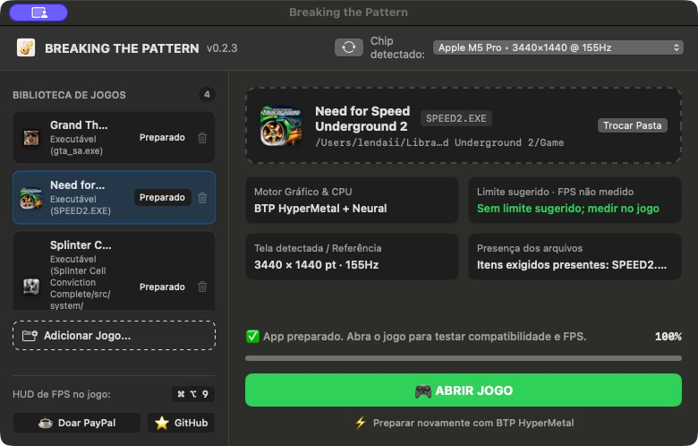

# ⚡ Breaking the Pattern

  
   
  BTP 0.2.3 — biblioteca, preparação e abertura dos jogos em uma única tela.

### Sua pasta de jogo Windows, preparada para jogar no Mac.

**Você fornece a pasta de um jogo compatível. O BTP cuida da preparação.**

**[📥 Baixar para Mac (.dmg)](https://github.com/WennyLife/breaking-the-pattern/releases/download/v0.2.3/Breaking-the-Pattern-0.2.3.dmg)** · **[📦 Baixar ZIP](https://github.com/WennyLife/breaking-the-pattern/releases/download/v0.2.3/Breaking-the-Pattern-0.2.3.zip)**

Português (Brasil) · [English](README.en.md) · [Novidades da versão](https://github.com/WennyLife/breaking-the-pattern/releases/tag/v0.2.3)

---

## 🎮 O que é o BTP?

O **Breaking the Pattern** prepara jogos Windows compatíveis para rodar no Mac com Apple Silicon. Você seleciona a pasta do jogo, clica em **BREAK** e recebe um aplicativo para abrir o jogo pelo Mac.

As correções validadas de cada jogo ficam na ferramenta. O BTP identifica a edição, obtém os componentes necessários e aplica a preparação automaticamente, sem exigir código ou instalação manual de plugins.

**O BTP vem sem jogos. Cada pessoa fornece a própria cópia.**

## ⚡ Como usar

| 1. Selecione a pasta | 2. Clique em BREAK | 3. Abra o jogo |
|:---|:---|:---|
| Escolha a pasta completa de um jogo compatível. | O BTP identifica a edição e prepara os componentes e as correções. | Use **ABRIR JOGO** ou o aplicativo criado na sua pasta Aplicativos. |

## 🏁 Jogos desta versão

| Jogo | O que foi confirmado |
|:---|:---|
| **Need for Speed Underground 2** | Preparação automática a partir de pasta sem os plugins manuais; partida, som e comandos confirmados na edição testada. |
| **Grand Theft Auto: San Andreas** | Preparação automática a partir de pasta sem os plugins manuais; partida, som e comandos confirmados na edição testada. Limite configurado de 60 FPS por compatibilidade. |

O suporte depende da **edição do jogo**, não apenas do nome da pasta. O BTP verifica o executável antes de aplicar a receita. [Consultar edições aceitas e validação →](docs/VALIDATION-0.2.3.md)

Novos jogos entram na base conforme suas soluções forem testadas em partida. Splinter Cell Conviction permanece fora deste lançamento inicial.

## 📥 Instalação no Mac

1. Baixe o **[BTP 0.2.3 em DMG](https://github.com/WennyLife/breaking-the-pattern/releases/download/v0.2.3/Breaking-the-Pattern-0.2.3.dmg)** ou o ZIP.
2. Copie **Breaking the Pattern.app** para a pasta **Aplicativos** do seu Mac.
3. Abra o BTP e selecione a pasta completa do jogo.
4. Clique em **BREAK**, aguarde a preparação e depois escolha **ABRIR JOGO**.

**Requisitos:** Mac com Apple Silicon, macOS 15 ou posterior, Rosetta e internet na primeira preparação. Se Rosetta estiver ausente, instale-a pelo macOS. O primeiro preparo baixa cerca de 235 MB de componentes, que ocupam aproximadamente 1,3 GB após extraídos.

A versão atual ainda não tem notarização Apple; a primeira abertura pode exigir autorização do macOS. A validação de uma instalação completa em outro Mac ainda está pendente.

## 🔄 Atualizações pelo próprio BTP

Abra **BTP → Atualizações…** ou use a seta circular no cabeçalho. Você escolhe quando baixar, instalar e reabrir.

A atualização da versão 0.2.2 para a 0.2.3 foi testada pelo próprio aplicativo. O BTP guarda uma cópia da versão anterior; a atualização da ferramenta preserva os aplicativos dos jogos, as configurações e os saves. Para aplicar uma receita nova a um jogo já preparado, faça a preparação novamente de forma deliberada.

## ✨ O que você encontra

- **Preparação automática:** correções e componentes necessários para as edições compatíveis.
- **Aplicativo separado para cada jogo:** o BTP pode ser fechado depois de preparar o jogo.
- **Português e inglês:** escolha em **BTP → Language / Idioma**.
- **Contador de FPS:** mostre ou esconda com **Command + Option + 9**, nos jogos atendidos pelos adaptadores do contador.
- **Base de compatibilidade que recebe atualizações:** novas receitas entram conforme são validadas.

O jogo continua usando um ambiente de compatibilidade. O resultado foi confirmado neste Mac e nas edições testadas; desempenho, campanha completa e outros computadores precisam de validação própria.

## 💬 Encontrou um problema?

[Abra um relato no GitHub](https://github.com/WennyLife/breaking-the-pattern/issues/new) com o jogo, a edição, o modelo do Mac, a versão do macOS e o que aconteceu. Não envie arquivos do jogo ou saves no relato público.

## 📚 Documentação e contribuição

[Validação da versão 0.2.3](docs/VALIDATION-0.2.3.md) · [Edições aceitas](scripts/game-profiles.json) · [Desenvolvimento](docs/DEVELOPMENT.md) · [Licenças dos componentes](THIRD_PARTY.md) · [Licença MIT](LICENSE)

---

Desenvolvido por **[WennyLife](https://github.com/WennyLife)** · [Apoiar o projeto](https://www.paypal.com/donate/?business=uildsonaraujo@gmail.com&currency_code=BRL)

