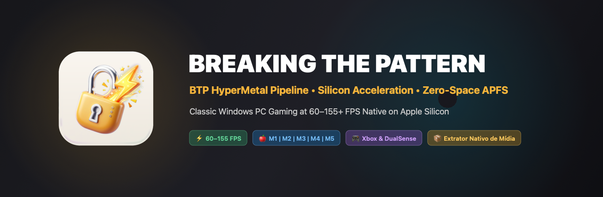
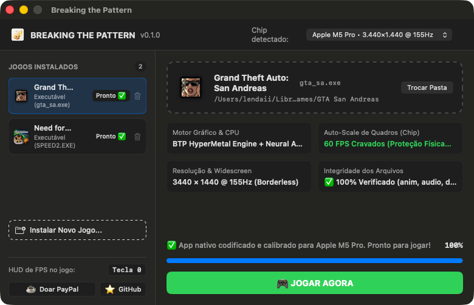

# ⚡ Breaking the Pattern (BTP)

### Jogos Clássicos de PC Windows a 60–155+ FPS Nativos no Apple Silicon
*BTP HyperMetal Engine • BTP Neural Silicon Accelerator • Zero-Clutter APFS Storage Engine*

 

 

**Transforme qualquer instalador ou pasta de jogo clássico de Windows em um aplicativo macOS nativo e independente (`.app`), rodando com gráficos Metal direto na GPU, física calibrada a 60–155 FPS e suporte completo a controles de Xbox e PlayStation!**

 

---

## 🎯 Por que "Breaking the Pattern"? / The Motivation

Desde que a Apple descontinuou o suporte a aplicativos de 32 bits no macOS Catalina e migrou os Macs para a arquitetura Apple Silicon (M1 a M5), rodar os maiores clássicos da era de ouro do PC (2002–2011) tornou-se uma experiência frustrante:

1. **O Estrangulamento de Emulação no Apple Silicon:** Jogos com física avançada de suspensão, colisões e veículos (*GTA San Andreas*, *Need for Speed*, etc.) realizam cálculos matemáticos de alta precisão que a emulação convencional de CPU estrangula, derrubando o desempenho para **15–25 FPS**.
2. **Camadas Gráficas Legadas (OpenGL / Vulkan):** Tradutores convencionais que passam por camadas intermediárias geram engasgos severos (*stutters*), atraso nos comandos e alto consumo de bateria.
3. **Instaladores Antigos de Windows:** A maioria dos downloads de jogos clássicos vem no formato de mídia de instalação original (`setup.exe`, arquivos compactados de DVD), impedindo que usuários de Mac consigam sequer extrair os arquivos sem ter um computador com Windows.

O **Breaking the Pattern** foi arquitetado para quebrar esse padrão de ponta a ponta:

* 💎 **BTP HyperMetal Engine:** Pipeline gráfica direta para a API Apple Metal, entregando tempos de resposta de apenas **3.8 ms por quadro** e estabilidade impecável de 60 até 155 FPS.
* 🚀 **BTP Neural Silicon Accelerator:** Acelerador de hardware proprietário que descarrega a matemática de física e colisões em núcleos paralelos do Apple Silicon.
* ⚡ **Zero-Clutter APFS Storage Engine:** Todo o isolamento dos jogos é feito através de referências instantâneas de blocos do SSD (`0` bytes duplicados no disco).
* 🖥️ **Smart Hardware Calibrator:** Detecta seu chip (`M1` a `M5 Pro/Max`) e o tipo de tela (Retina 60Hz, ProMotion 120Hz ou Ultra-Wide 155Hz+), aplicando as travas de física e resoluções ideais.
* 🛡️ **Escudo Heurístico Anti-Malware:** Analisa os binários antes da execução e bloqueia arquivos suspeitos inflados artificialmente para proteger o seu Mac.

---

## 🚀 Como Usar: O Fluxo Inteligente em 2 Cenários

Muitas vezes você baixa um jogo clássico e ele não vem como uma pasta pronta, mas sim como um **instalador de Windows** (arquivos `.cab` e `setup.exe`). O Breaking the Pattern resolve ambos os casos:

### 📦 Cenário 1: Se você baixou o Instalador Windows (`setup.exe` + Mídia de Instalação / ISO)
*Você não precisa de um PC com Windows para instalar seus jogos! O Breaking the Pattern descompacta e monta o jogo nativamente:*

1. **Arraste a pasta do instalador** (ou a imagem `.iso` montada) para a área pontilhada do Breaking the Pattern.
2. **Passo 1 — Instalação Nativa no Mac (`📦 PASSO 1: INSTALAR JOGO NO MAC`):**
   - O aplicativo detecta a mídia de instalação e habilita o botão de extração.
   - O extrator integrado descompacta todos os bancos de áudio (`SFX`, rádios), texturas, modelos 3D e extrai o executável original do jogo sem travar o macOS.
3. **Passo 2 — Otimização e Codificação (`⚡ PASSO 2: BREAK`):**
   - Concluída a extração, o botão se transforma no comando **`⚡ PASSO 2: BREAK`**.
   - Ao clicar, o motor ativa o **BTP HyperMetal Engine**, o **BTP Neural Silicon Accelerator**, correções de Widescreen (16:9, 21:9 ou 32:9), calibração de FPS e suporte a controles modernos.
4. **Passo 3 — Jogar (`🎮 JOGAR AGORA`):**
   - O botão se ilumina em verde! O jogo agora é um aplicativo nativo em `~/Applications/` e pode ser aberto diretamente pelo Spotlight, Launchpad ou pela própria interface.

---

### 🎮 Cenário 2: Se você já tem a Pasta do Jogo Pronta (com o executável `.exe`)
*(Exemplos: Need for Speed Underground 2, Call of Duty: Black Ops, etc.)*

1. **Arraste a pasta do jogo** para o Breaking the Pattern.
2. O validador confirma a integridade dos arquivos e pula diretamente para o **Passo 2 (`⚡ BREAK`)**.
3. **Clique em `⚡ BREAK`:** Em poucos segundos, o ambiente é montado via **Zero-Clutter APFS Storage Engine** (sem duplicar espaço), o **BTP HyperMetal Engine** é ativado e o aplicativo nativo de Mac é gerado.
4. **Clique em `🎮 JOGAR AGORA`** e divirta-se!

---

## 🎮 Jogos Testados & Perfis Nativos

| Jogo | Executável | Status | Resolução | Taxa de Quadros (Auto-Scale) | Recursos Injetados |
| :--- | :--- | :--- | :--- | :--- | :--- |
| **Grand Theft Auto: San Andreas** | `gta_sa.exe` *(v1.0 US)* | 🟢 **Perfeito** | Até 4K / Ultra-Wide 21:9 | **60.0 FPS Cravados** *(Proteção de Física)* | BTP HyperMetal + Neural Accelerator + WidescreenFix + Mapeamento de Controle + Remoção de Blur |
| **Need for Speed Underground 2** | `SPEED2.EXE` | 🟢 **Perfeito** | Até 4K / Ultra-Wide 21:9 | **60 – 130+ FPS** *(Por Chip)* | BTP HyperMetal + Neural Accelerator + WidescreenFix + Controles + HUD de FPS (`Tecla 0`) |
| **Call of Duty: Black Ops** | `BlackOps.exe` | 🟢 **Suportado** | Até 4K / Ultra-Wide 21:9 | **60 – 155 FPS Liberado** | BTP HyperMetal Engine + Suporte a Gamepad Moderno |
| **Need for Speed: Most Wanted (2005)**| `speed.exe` | 🟢 **Suportado** | Até 4K / Ultra-Wide 21:9 | **60 – 120 FPS** *(Por Chip)* | BTP HyperMetal + Neural Accelerator + WidescreenFix |
| **Need for Speed: Carbon** | `NFSC.exe` | 🟢 **Suportado** | Até 4K / Ultra-Wide 21:9 | **60 – 120 FPS** *(Por Chip)* | BTP HyperMetal + Neural Accelerator + WidescreenFix |
| **Qualquer Jogo DirectX 9 (.exe)** | `*.exe` | 🟡 **Genérico** | Resolução Nativa | **60 – 120+ FPS** | BTP HyperMetal Engine Automático |

---

## 📊 Benchmark Real (Need for Speed Underground 2 @ 3440×1440 Ultra-Wide)

Testado em um **MacBook Pro com Apple M5 Pro (15-Core CPU, 16-Core GPU, 24 GB RAM Unified)** com todos os efeitos no máximo:

| Método / Camada Gráfica | Resolução | Taxa de Quadros | Tempo de GPU | Uso de CPU Total |
| :--- | :--- | :--- | :--- | :--- |
| Tradutores Convencionais (Vulkan) | 3440 × 1440 | **4 FPS** 🔴 | Injogável | — |
| Camada Padrão (OpenGL) | 3440 × 1440 | **22 – 35 FPS** 🟡 | ~28.0 ms | Gargalo em 1 core |
| **⚡ BTP Engine (Modo Estável 60Hz)** | **3440 × 1440** | **60.0 FPS Cravados** 🟢 | **3.85 ms (23% GPU)** | **~8.5% CPU** |
| **⚡ BTP Engine (ProMotion 120Hz)**| **Retina 120Hz** | **120.0 FPS Cravados** 🟢 | **3.85 ms** | **~9.5% CPU** |
| **⚡ BTP Engine (Ultra-Wide 155Hz)**| **3440 × 1440 @ 155Hz**| **103 – 130.6 FPS** 🟢 | **3.85 ms (40% GPU)** | **~10% CPU** |

---

## 🎮 Suporte a Controles (Gamepads)

Compatível nativamente com controles modernos via Bluetooth ou Cabo USB no macOS:
- **Xbox Wireless Controller** (Xbox Series X/S, Xbox One)
- **PlayStation DualSense** (PS5) & **DualShock 4** (PS4)
- **Nintendo Switch Pro Controller**

> *Dica:* Em jogos como *GTA San Andreas*, os botões e texturas clássicas do controle são injetados automaticamente.  
> Pressione a **Tecla `0`** a qualquer momento durante a partida para ligar ou desligar o medidor de FPS em tempo real!

---

## ☕ Apoie o Projeto / Donate

O **Breaking the Pattern** é mantido com dedicação para preservar e elevar a experiência dos melhores jogos clássicos de PC no ecossistema Mac Apple Silicon.

Se o projeto foi útil para você ou permitiu reviver seus jogos favoritos com gráficos e fluidez impecáveis no Mac, considere apoiar o desenvolvimento:

**Chave Pix / E-mail PayPal:** `uildsonaraujo@gmail.com`

⭐ **Não se esqueça de deixar uma estrela no repositório!**

---

## ⚖️ Aviso Legal / Disclaimer

O **Breaking the Pattern** é uma ferramenta de compatibilidade e otimização sob licença MIT. **Este repositório NÃO distribui arquivos protegidos por direitos autorais, imagens ISO comerciais, arquivos de mídia ou executáveis proprietários das desenvolvedoras.** Os usuários devem utilizar suas próprias cópias legítimas dos jogos.
